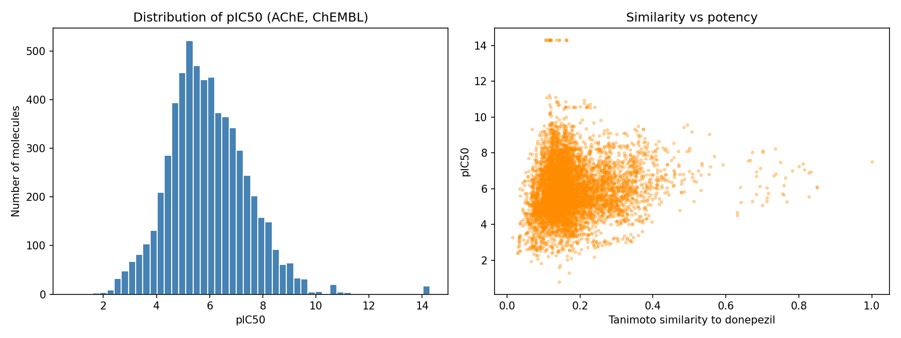
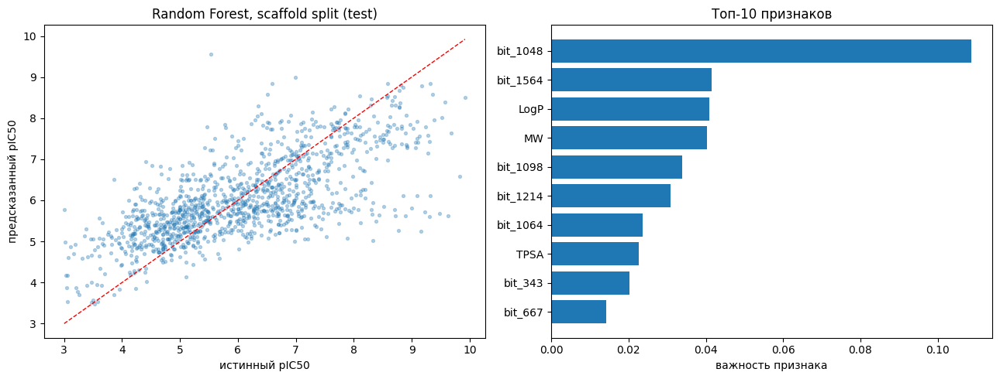
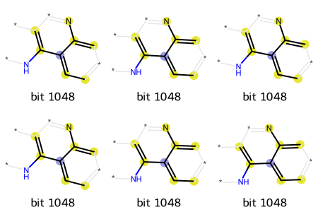
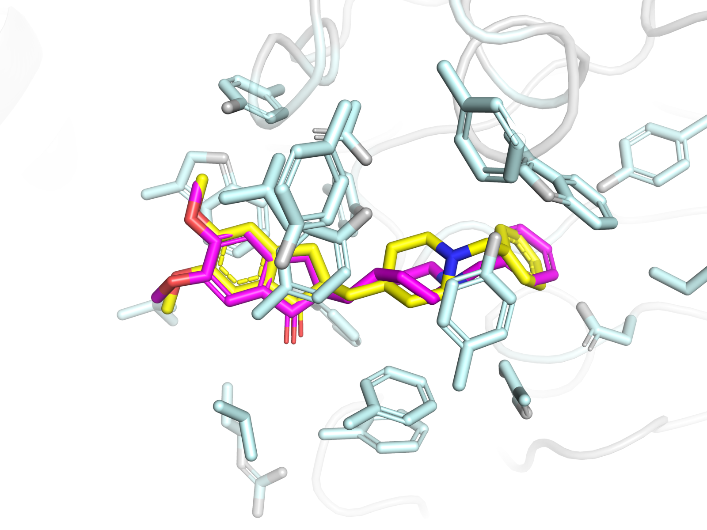
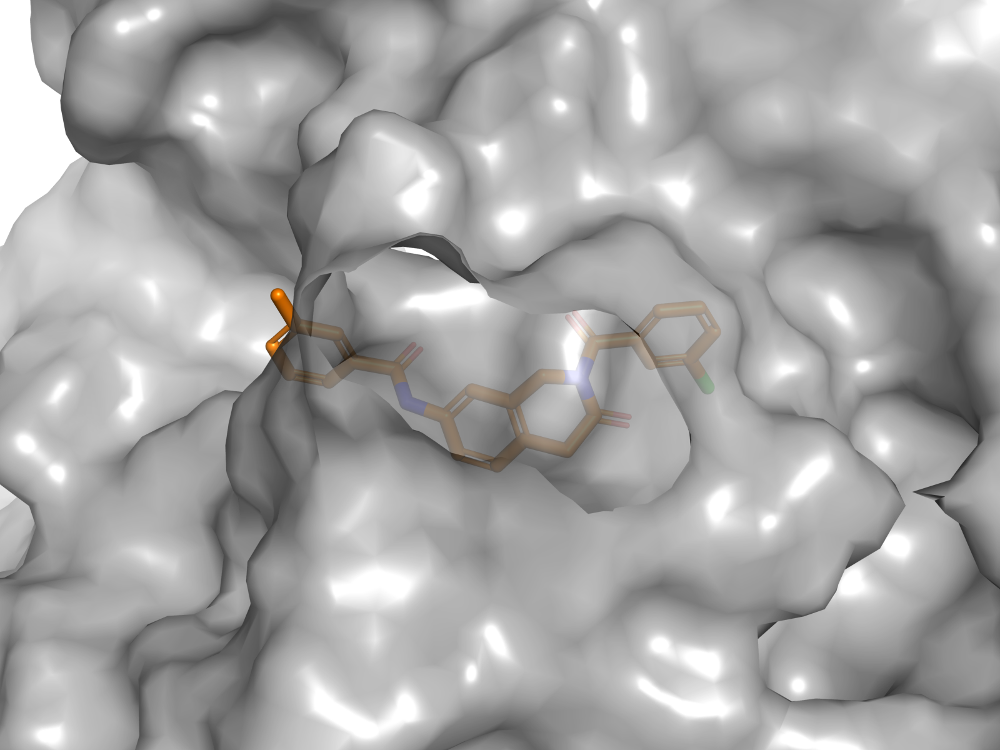

# Acetylcholinesterase inhibitors in ChEMBL: does similarity to donepezil predict activity?

I collected every IC50 measurement for human acetylcholinesterase (AChE) available in ChEMBL, cleaned the data, calculated physicochemical descriptors, and checked whether molecules that resemble donepezil are also more potent. I then trained a Random Forest model on pIC50. On a scaffold split, which tests the model on chemistry it has not seen, it reaches R² = 0.49 (0.74 on a random split).

## Question

AChE is a therapeutic target in Alzheimer's disease. Patients lose cholinergic neurons, and inhibiting AChE raises acetylcholine levels, which partly makes up for that loss. Donepezil is an approved AChE inhibitor.

I wanted to know three things:

1. How potent are the molecules reported against AChE in public data?
2. How well does structural similarity to donepezil tell us whether a molecule is potent?
3. Can a model predict potency for chemistry it has not seen?

## Data

- **Source:** ChEMBL, target `CHEMBL220` (human acetylcholinesterase), activity type IC50
- **Accessed:** 7 November 2026 via chembl_webresource_client, database release ChEMBL_37 (released 1 May 2026).
- **Starting point:** 10,079 IC50 records

### Curation

| Step | Records left |
|---|---|
| Initial IC50 records for CHEMBL220 | 10,079 |
| Units standardized to nM | 8,723 |
| Exact values only (relation "=") | 7,827 |
| No missing values; values > 0 | 7,825 |
| One value per molecule (median) | 6,287 molecules |
| Salts and mixtures removed, values re-aggregated | 6,174 molecules |
| pIC50 between 3 and 11 | 6,044 molecules |

Notes on each step:

- **Units.** 1,265 records had no standardized unit (no value reported). 83 records were given in µg/mL and 8 had malformed unit strings. I excluded the µg/mL and malformed records: converting µg/mL to nM needs the molecular weight of every compound, and these 91 records are under 1% of the data. 
- **Censored values.** I excluded 859 records with >, 12 with <, 2 with ~, 2 with >> and 21 with no relation recorded: 896 in total, all censored values with no measured IC50.
- **Salts and mixtures.** 1,035 molecules contained several fragments. I kept the largest one. After converting to canonical SMILES, 113 of these molecules merged with molecules that were already in the dataset.
- **Suspicious values.** 17 different molecules shared the same IC50 of 0.000005 nM (5 fM). That is far below the picomolar potencies reported even for the most potent AChE inhibitors, so I treated it as a curation artifact. These records fall outside the pIC50 range below and were removed at that step.
- **pIC50 range.** I chose the range 3 to 11 by hand and report it here for transparency. It removed 130 molecules (6,174 to 6,044).

## Methods

`pIC50 = 9 - log10(IC50 in nM)`

Descriptors calculated with RDKit:

| Descriptor | What it is |
|---|---|
| MW | Molecular weight in daltons (Da) |
| LogP | Calculated octanol-water partition coefficient (RDKit's Crippen method), a measure of lipophilicity |
| HBD | Number of hydrogen bond donors (N-H and O-H groups) |
| HBA | Number of hydrogen bond acceptors (N and O atoms) |
| TPSA | Topological polar surface area in Ų, used to estimate membrane permeability |

**Lipinski's rule of five** is a rough filter for drug-likeness. Poor oral absorption is more likely when a molecule breaks more than one of these limits: MW ≤ 500, logP ≤ 5, HBD ≤ 5, HBA ≤ 10. I report both the strict count (no violations) and Lipinski's own criterion (at most one violation).

**Morgan fingerprints** (radius 2, 2048 bits, also called ECFP4) describe each molecule as a 2048-bit vector that encodes the neighborhood of every atom up to 2 bonds away.

**Tanimoto similarity to donepezil** (CHEMBL502) is the number of fingerprint bits two molecules share, divided by the number of bits set in either one. It runs from 0 (nothing in common) to 1 (identical fingerprints).

## Statistics

**Spearman correlation between Tanimoto similarity to donepezil and pIC50:** rho = 0.13, p = 1e-23. The correlation is statistically significant but weak: similarity explains under 2 percent of the variance in rank.

**Mann-Whitney U test,** molecules with similarity 0.4 or above (n = 144) against the rest (n = 5,900): p = 2.8e-16, difference in medians 0.96 log units, about ninefold in potency.

With a sample of this size almost any difference reaches significance, so the effect size is reported alongside the p-value.

**Tests were chosen for the data:** Spearman rather than Pearson because only a monotonic relationship is expected and the data contain outliers; Mann-Whitney rather than a t-test because group sizes differ greatly and normality is not assumed.

## Results

Median pIC50 is 5.85 (IC50 about 1.4 µM), so most compounds reported against AChE are moderately potent at best. Defining an active compound as pIC50 >= 7 (IC50 <= 100 nM), 1,397 of 6,044 molecules (23.1 percent) are active. The threshold is my own and is stated here so the number can be interpreted.

Median TPSA is 56.8 Ų, below the value of 90 often used as a rough ceiling for blood-brain barrier penetration. This matters for a CNS target.

Molecules with Tanimoto similarity 0.4 or above to donepezil (n = 144) have a median pIC50 of 6.77 against 5.81 for the rest.

Donepezil itself is present in the dataset with a similarity of 1.0 and pIC50 about 7.5, which serves as a sanity check.

**Lipinski violations by criterion:** LogP above 5 in 2,076 molecules (34.3 percent), MW above 500 in 1,278 (21.1 percent), HBD above 5 in 34, HBA above 10 in 36. Lipophilicity is the dominant reason for failure, hydrogen bonding is almost never the limiting factor.

**Distribution of violations:** 0 in 3,713 molecules, 1 in 1,277, 2 in 1,025, 3 in 19, 4 in 10.

Under the strict reading (no violations at all) 3,713 of 6,044 molecules pass (61.4 percent). Under Lipinski’s original formulation, which allows a single violation, 4,990 molecules pass (82.6 percent). Both numbers are reported; the second follows the rule as published.

Similarity to donepezil alone is a weak predictor of potency across the dataset (rho = 0.13), but compounds with high similarity are enriched in potent molecules.

## QSAR model

I trained a Random Forest regressor on pIC50 using the 2,048-bit Morgan fingerprint plus the five descriptors above (2,053 features; 300 trees, `min_samples_leaf=2`, fixed seed). Tanimoto similarity to donepezil was deliberately left out of the features: it is a distance to one particular molecule, not a property of the compound, and it would not exist in a real screening campaign.

### Scaffold split

Molecules were grouped by their Bemis-Murcko scaffold (2,539 scaffolds for 6,044 molecules). Whole scaffold groups were assigned to one side of the split, largest group first, so that no scaffold occurs on both sides: 4,835 training and 1,209 test molecules, zero shared scaffolds.

| Split | R² on test |
|---|---|
| Random 80/20 | 0.742 |
| Scaffold 80/20 | 0.489 |

Same model, same features, same seed. The random split overstates performance by 0.25 in R². ChEMBL contains large series of analogs — 144 molecules here reduce to a bare benzene scaffold, 77 to the tacrine core — and under a random split part of a series trains the model while the rest tests it, so the model is rewarded for recognizing a series it has already seen. The scaffold number describes performance on chemistry the model has not seen, and that is the number I report. The two groups of 144 are unrelated: no molecule belong to both.

On the scaffold split, RMSE is 1.00 log units against 1.40 for a baseline that always predicts the mean training pIC50: a 29 percent reduction in error.

The scaffold split is also less strict than it sounds. Murcko scaffolds are compared as SMILES strings, so two close analogs whose rings differ by a single atom receive different scaffolds and can still end up on opposite sides of the split. The true generalization gap is therefore at least as large as the table suggests.

Predicted against true values shows the flattening typical of an averaging regressor: low values are overpredicted, high values underpredicted. Compounds with a true pIC50 above 9 are predicted at 6 to 8. The model is usable for ranking candidates, not for quoting an absolute potency. Spearman correlation between predicted and true pIC50 on the test set is rho = 0.696, so the ranking is largely preserved even though absolute values are compressed.

### What the model uses

One fingerprint bit, bit 1048, carries 10.9 percent of the total feature importance, two and a half times the next feature. Decoding it with RDKit's bit-info map shows a 4-aminoquinoline motif — the core shared by tacrine and its analogs, the first drug class approved for Alzheimer's disease. 675 of the 6,044 molecules contain it, with a median pIC50 of 7.42 against 5.66 for the rest. The most important feature therefore corresponds to a known pharmacophore, which is consistent with the model learning real structure-activity relationships, although it may also reflect the size of this series. This last comparison is descriptive and uses the whole dataset, training molecules included, so it is not an independent validation.

The remaining top features are a mixture of further bits and the descriptors LogP, MW and TPSA.

A model that does not see similarity to donepezil reaches R² = 0.49 on unseen scaffolds, so structure carries much more information about potency than similarity to one drug.
## Docking

The model above works on structure alone and never looks at the protein. This section adds the
structural side: it places molecules into the acetylcholinesterase active site and asks whether a
docking score separates potent compounds from weak ones.

### Structure

Human acetylcholinesterase in complex with donepezil, PDB 4EY7, solved at 2.35 A. The crystal holds two
copies of the protein. I kept chain A, which carries one complete copy of donepezil, 28 heavy atoms,
matching the formula of donepezil in ChEMBL (CHEMBL502, C24H29NO3).

Preparation removed the waters, the N-glycans, and the ethylene glycol and nitrate ions left from
crystallization. Where a side chain was modelled in two conformations I kept the first. The model covers
530 of the 543 residues of the mature protein and has two gaps, residues 259 to 264 and 495 to 497. Both
lie in surface loops, 29.8 and 36.5 A from the center of the bound donepezil, so neither touches the
binding site and I did not rebuild them.

Hydrogens were added with Open Babel at pH 7.4, which leaves aspartate and glutamate deprotonated and
lysine and arginine protonated. The protein goes from 4,130 heavy atoms to 8,148 atoms in total.

### Redocking

Before docking anything new, the method has to reproduce something known. I rebuilt donepezil from its
SMILES string, generated a conformer with ETKDG, minimized it with MMFF, and docked it back into the
site using a search box built around the crystal ligand and extended by 4 A.

Starting from SMILES rather than from the crystal coordinates is deliberate. Handing the program the
answer would test only the search for a position, not the procedure that will be applied to molecules
whose structures are unknown.

The top pose scores -11.81 kcal/mol and sits 0.80 A from the crystallographic ligand. The second pose is
also within 1.08 A. The accepted threshold for a successful redocking is 2 A, so the method passes.
RMSD is computed in place, without superposing the two molecules, and accounts for the symmetry of the
aromatic rings.

### Screening

From the 6,044 curated molecules I took the 50 with the highest pIC50 and the 50 with the lowest and
docked each one with the same receptor and the same box. One molecule, CHEMBL1203984, could not be
embedded in three dimensions by ETKDG and was dropped, leaving 99.

The two groups are far apart by design: pIC50 from 9.57 to 10.96 among the actives against 3.00 to 3.20
among the inactives, more than six orders of magnitude in concentration. This is an easy discrimination
task and the numbers below should be read with that in mind.

| | n | median pIC50 | median MW | mean score | median score |
|---|---|---|---|---|---|
| Active | 50 | 10.49 | 434.9 | -11.08 | -11.41 |
| Inactive | 49 | 3.08 | 355.4 | -9.37 | -9.93 |

Ranking the 99 molecules by docking score gives ROC-AUC 0.766 and PR-AUC 0.799 against a baseline of
0.505 set by the fraction of actives. Four of the five best scoring molecules have a measured pIC50
above 10, so the top of the list is enriched in real inhibitors, which is what a screen is for.

The best scoring molecule is CHEMBL4214707 at -14.29 kcal/mol, with a measured pIC50 of 10.68.

### How much of that is just size

The Vina scoring function sums contributions over pairs of atoms, so a larger molecule tends to score
better simply by having more atoms, and the actives here are heavier than the inactives, 435 against 355
daltons at the median. That makes the control necessary rather than optional.

Score correlates more strongly with molecular weight (Spearman rho = -0.614, p = 1.4e-11) than with
potency (rho = -0.449, p = 3.1e-06). Molecular weight on its own separates the two groups with ROC-AUC
0.730, and the number of heavy atoms with 0.723, against 0.766 for the docking score. A descriptor that
takes no time to compute therefore recovers most of the separation.

Two corrections point the same way. Fitting score against the number of heavy atoms and ranking by the
residual gives ROC-AUC 0.640. Partial rank correlation between score and pIC50 at fixed molecular weight
is -0.392, down from -0.449. Ligand efficiency, the score divided by the number of heavy atoms, gives
0.360, below chance, which means the actives are worse per atom than the inactives: their advantage
comes from having more atoms rather than from a better fit per atom. Dividing by size overcorrects,
which is why I report the regression residual as the main control.

So docking does carry structural information beyond size, 0.640 is well above chance, but on this set
most of the separation is available from molecular weight alone.

### Settings

smina 2020.12.10, built on AutoDock Vina 1.1.2. Search box built around the crystal ligand with
--autobox_add 4. Exhaustiveness 16 for the redocking of donepezil, where one molecule is cheap and
precision matters, and 8, the AutoDock Vina default, for the 99 screened molecules. Random seed 42
throughout. Ligands were built from SMILES with RDKit ETKDG and minimized with MMFF before docking.
Figures rendered with open source PyMOL.

## Limitations

- IC50 values come from different assays and laboratories, so they are not strictly comparable.
- Similarity does not guarantee activity. Small structural changes can cause large drops in potency (activity cliffs).
- Excluding censored values (">") removes mostly weak or inactive compounds, so the data lean toward measurable activity.
- ChEMBL contains many series of analogs built around known drugs. Similarity to donepezil may partly reflect which compounds chemists chose to make and test.
- I used a single similarity cut-off (0.4) chosen by hand; a different threshold would change the size of the similar group.
- Keeping only the largest fragment is wrong for genuine two-component mixtures.
- Impurity-based feature importances in a Random Forest favor continuous features over binary bits, so the position of the descriptors in the ranking should be read with care.
- No hyperparameter search was performed and there is no validation set; the test set was used once, for the numbers reported here.
- Every number comes from a single run with one seed, so I cannot give a confidence interval.
- Docking was run on a single rigid receptor conformation. Acetylcholinesterase has a flexible gorge, and
  side chains that would move to accommodate a ligand cannot do so here.
- Each molecule was docked once, from one starting conformer, with one random seed, so no uncertainty is
  attached to any individual score.
- The screening set is the two extremes of the potency range. Performance on molecules of intermediate
  potency, which is where a screen actually has to work, is not measured here.
- The actives are heavier than the inactives, and docking scores grow with molecular size, so part of the
  separation reflects size rather than binding. The size corrected numbers are reported above.
- Protonation states were assigned by a rule based tool at a single pH and were not checked by hand for
  individual ligands.
  
## Reproducing

All results use random_state = 0. Run with scikit-learn 1.6.1 and rdkit 2026.09.1

Open ache_virtual_screening.ipynb in Google Colab and run all cells. The docking section is reproduced by ache_docking.ipynb in the same way. ChEMBL is updated regularly, so the numbers may differ slightly from the ones above.

Docking used smina 2020.12.10 and Open Babel 3.1.0, installed with conda into a separate environment, and
open source PyMOL for the figures. The screening run takes about four hours on the two cores of a free
Colab instance.
